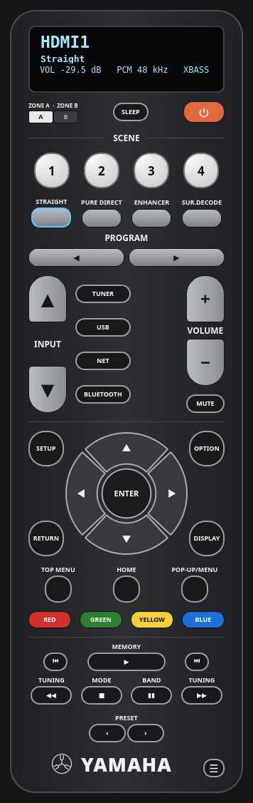
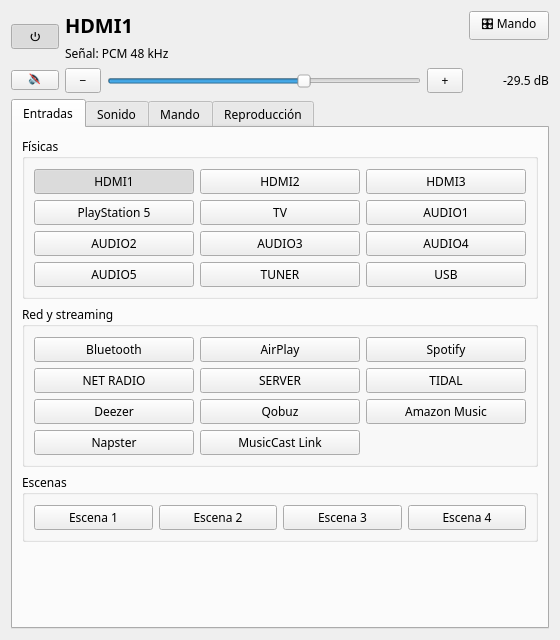

# Yamaha RX-V4A · control desde el PC

Control de escritorio para receptores AV **Yamaha MusicCast** (probado con el **RX-V4A**),
pensado para Linux. Yamaha solo publica la app MusicCast para Android e iOS; esta app
habla directamente con la misma API de red del receptor (*Yamaha Extended Control*),
así que no hace falta el móvil ni el mando físico.

| Vista mando | Vista completa |
|---|---|
|  |  |

## Qué hace

- **Vista mando**: réplica del mando original, con una pantalla tipo display arriba
  (entrada, programa de sonido, volumen en dB, señal que llega, canción o emisora).
  Clic en el nombre de la entrada o del programa para elegir de una lista.
- **Vista completa** por pestañas: entradas y escenas, sonido (graves, agudos,
  subwoofer, diálogo, Extra Bass, Adaptive DRC, retardo de audio, apagado
  automático), cursor y menús en pantalla, y reproducción.
- Se cambia de vista con **☰** (en el mando) y **🎛 Mando** (en la vista completa);
  recuerda la última.
- **Icono en la bandeja**: clic izquierdo muestra u oculta; clic derecho para
  encender, silenciar, volumen, entrada y vistas. Al cerrar la ventana sigue en la bandeja.
- Cursor y menús del receptor (**SETUP, OPTION, ENTER, RETURN…**) para moverte por el
  menú que sale en la TV.
- **ZONE A / ZONE B**, presintonías, sintonizador FM/DAB y reproducción de red
  (Spotify, AirPlay, Bluetooth, radio, USB).

## Requisitos

- Python 3.9 o superior y **PyQt6** (con QtSvg).
  - Arch / CachyOS: `sudo pacman -S python-pyqt6`
  - Debian / Ubuntu: `sudo apt install python3-pyqt6 python3-pyqt6.qtsvg`
  - pip: `pip install -r requirements.txt`
- El receptor en la misma red local.

## Instalación

```sh
git clone https://github.com/isma123nassif/openyamaha-control.git
cd openyamaha-control
./install.sh                # lanzador en el menú de aplicaciones
./install.sh --autostart    # además, arranque minimizado en la bandeja al iniciar sesión
./install.sh --uninstall    # quitarlo
```

## Configuración

La IP del receptor se indica una vez y queda guardada en
`~/.config/yamaha-control/yamaha-control.conf`:

```sh
python3 yamaha_control.py --host 192.168.1.50
```

También vale la variable de entorno `YAMAHA_HOST`. Para encontrar la IP: en el propio
receptor (Setup → Network), en el router, o con
`avahi-browse -atrp | grep -i yamaha`.

Otras opciones: `--tray` arranca oculto en la bandeja.

## Otros receptores

Las entradas, los programas de sonido y los nombres se leen del propio receptor, así
que otros modelos MusicCast deberían funcionar en buena parte. Algunos botones (ZONE B,
DAB, decodificadores concretos) dependen del modelo.

## Aviso

Proyecto personal sin relación con Yamaha Corporation. «Yamaha», «MusicCast» y el
emblema de los diapasones son marcas de Yamaha Corporation; el emblema de la app es un
dibujo aproximado hecho a mano.

## Licencia

[MIT](LICENSE)
